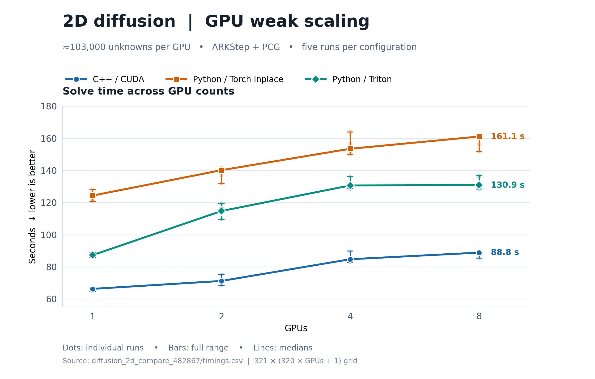

# 2D diffusion: CUDA/MPI weak scaling study

## Problem

We solve a forced, two-dimensional heat equation on a rectangular domain that
grows with the number of GPUs, $P$:

$$
\Omega_P=[0,1]\times[0,P],\qquad
\frac{\partial u}{\partial t}
=k_x\frac{\partial^2u}{\partial x^2}
 +k_y\frac{\partial^2u}{\partial y^2}+b(t,x,y),
\qquad 0\le t\le 1,
$$

with $k_x=k_y=1$ and zero values on the physical boundary. Define

$$
s(x,y)=\sin^2(\pi x)\sin^2(\pi y).
$$

The initial condition is $u(0,x,y)=s(x,y)$. A manufactured source gives the
exact solution

$$
u_{\mathrm{exact}}(t,x,y)=s(x,y)\cos^2(\pi t),
$$

where

$$
\begin{aligned}
b(t,x,y)={}&-\pi\sin(2\pi t)s(x,y)\\
&-2\pi^2\cos^2(\pi t)\left[
k_x\cos(2\pi x)\sin^2(\pi y)
+k_y\cos(2\pi y)\sin^2(\pi x)
\right].
\end{aligned}
$$

The spatial operator uses a five-point, second-order centered-difference
stencil. For example, at an interior grid point $(i,j)$,

$$
\frac{du_{ij}}{dt}=
k_x\frac{u_{i-1,j}-2u_{ij}+u_{i+1,j}}{h^2}
+k_y\frac{u_{i,j-1}-2u_{ij}+u_{i,j+1}}{h^2}
+b(t,x_i,y_j),\qquad h=\frac{1}{320}.
$$

The $y$ direction is partitioned across MPI ranks, with one rank per GPU. The
global mesh is $N_x\times N_y=321\times(320P+1)$, so each added GPU extends
the domain by one unit while preserving the spacing and local work. Rank zero
owns 103,041 grid values; each other rank owns 102,720.

| GPUs / MPI ranks | Active nodes | Global mesh | Global grid values |
| ---: | ---: | ---: | ---: |
| 1 | 1 | $321\times321$ | 103,041 |
| 2 | 1 | $321\times641$ | 205,761 |
| 4 | 2 | $321\times1281$ | 411,201 |
| 8 | 4 | $321\times2561$ | 822,081 |

## Machine and software

The study ran on LLNL's **Matrix** cluster in Slurm's `pbatch` partition. The
Matrix CUDA setup identifies the compute GPUs as **NVIDIA H100** (compute
capability 9.0). The batch allocation requested four nodes, two GPUs per node,
two MPI tasks per node, and four CPUs per task. Each benchmark step used
only the active nodes and GPUs shown above. The completed eight-GPU job log
contains the hostnames `matrix14`, `matrix19`, `matrix43`, and `matrix48`.

The [batch script](../scripts/matrix/run_diffusion_2d_python_cpp_weak_scaling.sbatch)
loads GCC 13.3.1, MVAPICH2 2.3.7, Python 3.12, CUDA 12.6, and CMake 3.30.5.
The Python environment reports Python 3.12.2, PyTorch 2.4.0+cu121,
Triton 3.0.0, and mpi4py 3.1.6. The C++ executable was built with
`RelWithDebInfo` and CUDA architecture 90. Both implementations use this
SUNDIALS checkout; the Python binding is installed in editable mode with MPI
and CUDA enabled. The exact CPU model, node memory, network fabric, GPU driver,
and source revision were not recorded in the benchmark output.

## Numerical and experimental setup

All three implementations use an adaptive, third-order implicit ARKStep method
with relative tolerance $10^{-5}$ and absolute tolerance $10^{-10}$. The linear
solver is matrix-free PCG with at most 20 iterations per solve and a Jacobi
preconditioner. The ARKStep adaptivity controller is `I`; the default linear
tolerance factor and preconditioner setup frequency are selected by passing
zero. The simulation advances to $t_f=1$ through 20 output times.

The implementations differ in the right-hand-side calculation:

1. **C++ / CUDA:** native CUDA stencil kernels with MPI halo rows staged
   through host memory (`--host-staging`).
2. **Python / Torch inplace:** `sundials4py` with PyTorch tensor operations and
   host-staged MPI halo rows.
3. **Python / Triton:** the same `sundials4py` solver with fused Triton kernels
   for the interior and boundary stencil; halo rows are host-staged.

For each GPU count, five repeats were run. Each repeat executed C++ once and
then both Python modes; the Python mode order alternated between repeats. The
reported `SOLVE_SECONDS` is the **maximum over MPI ranks** of accumulated
`ARKodeEvolve` intervals, including a CUDA synchronization after each
interval. Initialization, solution checks, and output writing are outside
these intervals. Triton performs a warmup before timing; any further
compilation triggered during `ARKodeEvolve` is included. The final error is
checked against the
manufactured solution; successful runs required an error no greater than
$10^{-2}$.

The first batch job, 482867, recorded the 1- and 2-GPU runs and the first
4-GPU C++/Torch-inplace pair. A Triton cache file error interrupted its next
step. The resumed job, 482955, reused those successful results and completed
the remaining comparisons. Triton used node-local, per-rank cache directories
in the resumed job. The combined CSV has five successful repeats for every
GPU count and Python mode.

## Results and data

The table gives median solve time in seconds across five repeats. Lower times
are better; ideal weak scaling would keep each method's time constant as $P$
increases.

| GPUs | C++ / CUDA | Python / Torch inplace | Python / Triton |
| ---: | ---: | ---: | ---: |
| 1 | 66.28 | 124.34 | 87.28 |
| 2 | 71.20 | 140.14 | 114.72 |
| 4 | 84.73 | 153.47 | 130.63 |
| 8 | 88.84 | 161.08 | 130.88 |

The raw paired timings are in [timings.csv](timings.csv), solver counters in
[integrator_stats.csv](integrator_stats.csv), and calculated medians in
[summary.csv](summary.csv). The [plot script](plot_weak_scaling.py) regenerates
the PNG, PDF, and SVG figures from the raw timings. The benchmark problem is
implemented in the [C++ benchmark](../benchmarks/diffusion_2D/README.md) and
[Python port](../benchmarks/diffusion_2D/python/diffusion_2D_torch_mpi.py).
